<h1 align="center">Rafael Cherfem</h1>

  

## 🛠️ Stack

  

## 🚀 Projetos

- **chegaJunto**: PWA para controle de caronas
- **workHub**: central de operações para rotina de suporte
- **emporio-frades**: landing page com painel para o dono editar o conteúdo

## 📈 Contribuições

<picture>
  <source media="(prefers-color-scheme: dark)" srcset="https://raw.githubusercontent.com/rafaelCherfem/rafaelCherfem/output/pacman-contribution-graph-dark.svg" />
  
</picture>

  
  
  

